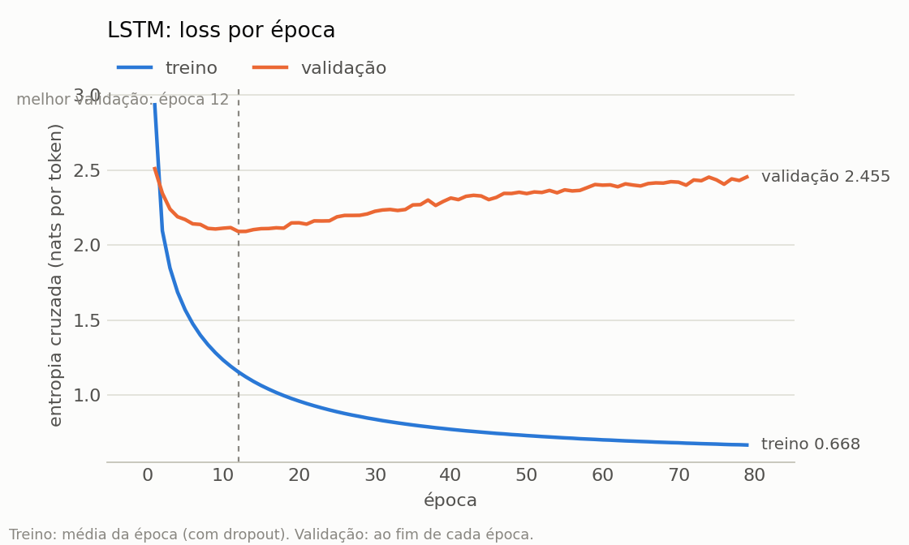

# LSTM: resultados

Gerado por `python scripts/step06_report.py --model lstm` a partir de `train_history.json`,
`run_info.json`, `test_metrics.json` e do resumo da geração.

## Arquitetura

LSTM empilhado (PyTorch nativo), com 2 camadas de largura 512 (embedding e estado), dropout entre camadas, LayerNorm e projeção de saída compartilhada com o embedding de entrada. Treinado e avaliado nas mesmas janelas de 1024 tokens do Transformer (o estado começa zerado em cada janela).

- Vocabulário: 1155 tokens do step01 (MIDI-like, 64 passos/s, 4 vozes)
- Parâmetros: 4.794.880

## Treino

| Hiperparâmetro | Valor |
|---|---|
| Otimizador | AdamW, lr 0.0003, weight decay 0.01, clipping 1.0 |
| Lote | 8 janelas de até 1024 tokens |
| Janelas de treino | passo 512 (contexto / 2), 16.640 janelas |
| Dropout | 0.1 |
| Precisão | BF16 misto |
| Semente | 42 |
| Épocas | 79 |
| Tempo de treino | 2 h 11 min (1 min 40 s por época) |
| Hardware | NVIDIA GeForce RTX 3090 Ti (PyTorch 2.9.1+cu128) |

Dados: partições oficiais do NES-MDB, 4500 músicas de treino (8.743.119 tokens-alvo) e 402 de validação.

**Melhor época (menor loss de validação): 12**, com loss 2,0913, perplexidade 8,10 e acurácia 46,37%. O modelo entregue (`modelo.pt`) é o checkpoint dessa época.

## Teste

Perplexidade = exp(média da entropia cruzada, em log natural, de todos os tokens depois do BOS em cada música de teste): 435.683 tokens de 372 músicas.

| Medida | Loss (nats/token) | Perplexidade | Acurácia top-1 |
|---|---|---|---|
| **Janelas deslizantes** (passo 512) | **1,8814** | **6,56** | **50,07%** |
| Janelas disjuntas (passo 1024) | 1,8970 | 6,67 | 49,89% |

A medida principal é a de janelas deslizantes: cada token é pontuado uma vez, com pelo menos meio contexto de histórico. A de janelas disjuntas segue o mesmo método da validação no treino.

## Geração

100 continuações (protocolo em `scripts/protocol.py`): prompt de 4 s de uma música de teste, continuação de 12 s, temperatura 1.0, top-k 32, máscara de eventos válidos. Em média 484 tokens por continuação (mín. 130, máx. 1598). Arquivos em `resultados/amostras/lstm/`; referência real dos mesmos segundos em `resultados/amostras/referencia/`.

## Limitações

- **Sobreposição na mesma voz.** No step01, notas mais curtas que meio passo (1/128 s)
  são esticadas para 1 passo e passam a se sobrepor à nota seguinte da mesma voz:
  13,8% dos NOTE_ON do treino ocorrem com a voz já soando. O modelo aprende esse
  padrão, mas a máscara de geração o proíbe (as vozes do NES são monofônicas). A
  perplexidade inclui esses tokens; o Markov é medido sobre os mesmos dados.
- **Representação sem dinâmica nem timbre.** Os tokens guardam só altura e tempo
  (64 passos/s). Volume, duty cycle e envelopes do NES-MDB se perdem; o WAV é uma
  prévia chiptune aproximada.
- **Contexto limitado.** 1024 tokens equivalem a cerca de 17 s
  de música (~60 tokens/s no treino). Estrutura de prazo mais longo (repetições de
  seção, forma) fica fora do alcance do modelo.
- **Perplexidade por token.** Depende da tokenização; só é comparável com modelos
  que usam exatamente o mesmo vocabulário de 1155 tokens e a mesma definição.
- **Acurácia top-1.** Mistura tipos de token (TIME_SHIFT, NOTE_ON, NOTE_OFF) e só
  conta o acerto exato do próximo token; não mede a qualidade musical da geração.

### Observações de escuta

_A preencher depois de ouvir as amostras de `resultados/amostras/` (coerência com o prompt,
repetição, uso das quatro vozes, ritmo)._
