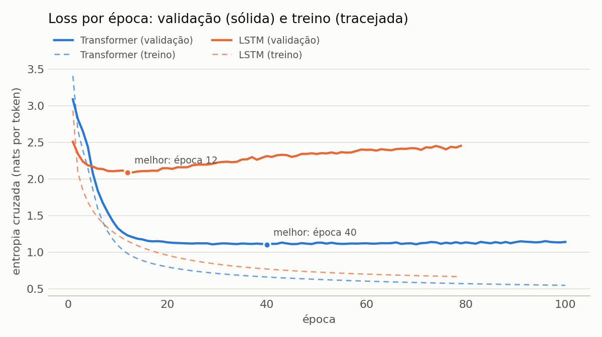
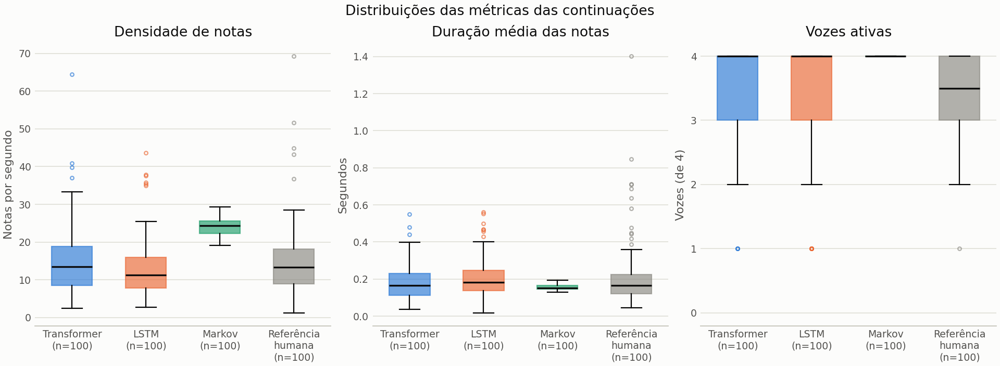
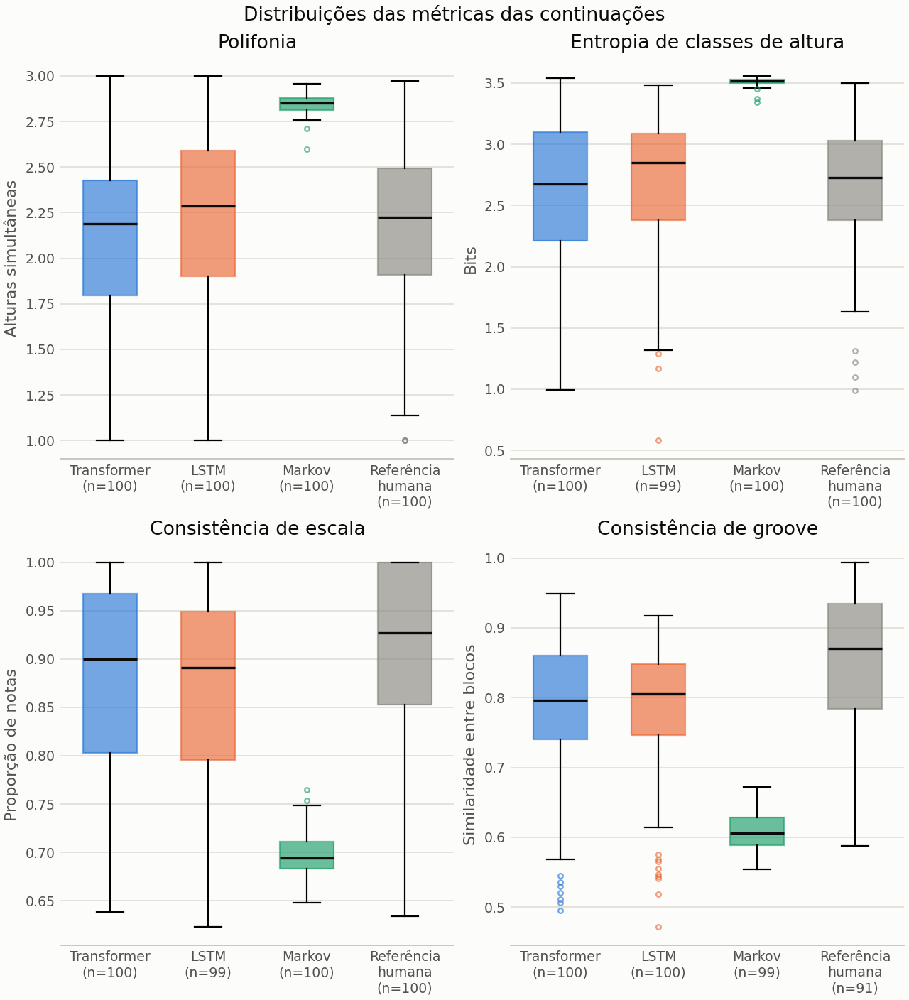

# Comparação entre os modelos

Gerado por `python scripts/step07_compare.py` a partir de `resultados/<modelo>/` e
`resultados/amostras/`. Os números também estão em `comparacao.json`.

## Métricas de predição (teste)

Perplexidade = exp(média da entropia cruzada, em log natural, de todos os tokens depois do BOS
das 372 músicas de teste; 435.683 tokens). Medida principal com janelas deslizantes (passo = contexto/2).

| Modelo | Parâmetros | Épocas treinadas | Melhor época | Loss de validação | Loss de teste | **Perplexidade de teste** | Perplexidade (janelas disjuntas) | Acurácia top-1 | Tempo de treino |
|---|---|---|---|---|---|---|---|---|---|
| Transformer | 5.296.896 | 100 | 40 | 1,1063 | 0,9042 | **2,470** | 2,686 | 74,32% | 52 min |
| LSTM | 4.794.880 | 79 | 12 | 2,0913 | 1,8814 | **6,562** | 6,666 | 50,07% | 132 min |

## Estatísticas das amostras geradas

Só a continuação (12 s depois do prompt de 4 s), média por música.
A referência é a continuação real das mesmas músicas: quanto mais perto dela, mais parecido com o
NES-MDB. *Desvio de altura* = |altura média da continuação − altura média do prompt| na mesma voz
(média de p1, p2 e tr, em semitons): mede se a continuação fica no mesmo registro do prompt.

| Conjunto | Músicas | Notas/s | Vozes ativas (de 4) | Duração média da nota (s) | Desvio de altura (semitons) |
|---|---|---|---|---|---|
| Transformer | 100 | 15,12 | 3,37 | 0,186 | 5,38 |
| LSTM | 100 | 13,33 | 3,31 | 0,208 | 7,62 |
| Markov | 100 | 24,01 | 4,00 | 0,157 | — |
| Referência (real) | 100 | 15,08 | 3,28 | 0,220 | 3,30 |

Cada caixa mostra a mediana e os quartis. Os bigodes vão até os valores dentro de 1,5
vez a amplitude interquartil, e os demais valores aparecem como pontos.
O n em cada grupo indica quantas músicas têm valor definido para a métrica.

| Conjunto | Polifonia | Entropia de classes de altura (bits) | Consistência de escala | Consistência de groove |
|---|---:|---:|---:|---:|
| Transformer | 2,083 | 2,606 | 0,878 | 0,778 |
| LSTM | 2,210 | 2,681 | 0,870 | 0,784 |
| Markov | 2,845 | 3,513 | 0,696 | 0,609 |
| Referência (real) | 2,165 | 2,657 | 0,903 | 0,850 |

Os valores da tabela são médias por música, considerando as amostras com valor definido
para cada métrica. O travessão indica que não há valor disponível.

A polifonia conta alturas distintas simultâneas nos instantes com som melódico, inclusive
notas do prompt que ainda soam na continuação. A entropia de Shannon (em bits) e a proporção
de notas na melhor escala maior ou menor natural usam os ataques da continuação.
As três métricas de altura excluem o canal de ruído.

A consistência de groove usa todos os canais e mede a proporção de posições com o mesmo
estado de ataque em blocos consecutivos de 2 s. Como os tokens guardam tempo absoluto,
a grade de referência equivale a 4/4 a 120 BPM, ancorada no início da continuação.
São usados apenas blocos completos, com pelo menos dois por amostra.

[Definições das métricas na documentação do MusPy](https://muspy.readthedocs.io/en/latest/metrics.html).

Por voz (notas por segundo / fração do tempo soando / alturas distintas):

| Conjunto | p1 | p2 | tr | no |
|---|---|---|---|---|
| Transformer | 3,91 / 0,71 / 9,6 | 4,36 / 0,69 / 9,3 | 4,36 / 0,50 / 8,6 | 2,49 / 0,26 / 1,9 |
| LSTM | 3,08 / 0,76 / 11,2 | 3,51 / 0,76 / 10,6 | 3,64 / 0,45 / 8,7 | 3,10 / 0,26 / 3,5 |
| Markov | 5,04 / 0,98 / 47,4 | 3,70 / 0,97 / 41,5 | 7,83 / 0,95 / 43,2 | 7,44 / 0,84 / 15,7 |
| Referência (real) | 3,85 / 0,76 / 9,3 | 4,09 / 0,75 / 9,8 | 3,52 / 0,51 / 6,8 | 3,62 / 0,25 / 1,6 |

Vozes: p1 e p2 = pulsos, tr = triângulo, no = ruído (a "altura" do ruído é o período, 1–16).
